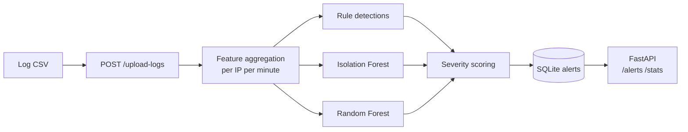

# AI SOC Alert Triage

A threat-detection backend that ingests security logs, flags suspicious activity with **rules plus machine learning**, scores each alert by severity, and exposes a REST API so an analyst can triage them.

**Stack:** Python, pandas, scikit-learn, FastAPI, SQLite

## What it does

1. **Ingests** logs (CSV) with fields such as timestamp, source IP, destination port, bytes, duration and failed logins.
2. **Aggregates** them into one row per source IP per minute.
3. **Detects** suspicious behaviour in two layers:
   - **Rules:** brute force, port scan, traffic spike
   - **ML:** an Isolation Forest (unsupervised anomaly score) and a class-weighted Random Forest (supervised)
4. **Scores** every alert 0-100 and labels it low, medium, high or critical.
5. **Maps** rule hits to MITRE ATT&CK techniques.
6. **Stores** alerts in SQLite so they can be filtered and moved through `open`, `investigating` and `closed`.

## Architecture



## Why both rules and ML?

Rules are transparent and fast, but an attacker who stays under the thresholds slips past them. The Isolation Forest flags behaviour that is unusual compared with normal traffic, even without a matching rule. The Random Forest learns known attack patterns from labelled data. The severity score combines all three so the analyst sees one ranked queue instead of three separate alert lists.

## Severity score

```
severity = 100 * (0.5 * RandomForest probability + 0.2 * anomaly score + 0.3 * rule signal)
```

| Band | Score |
|---|---|
| Critical | 80 and above |
| High | 60 to 79 |
| Medium | 40 to 59 |
| Low | below 40 |

The weights are a starting point and are easy to tune in `backend/pipeline.py`.

## Detection rules

| Rule | Trigger (per IP per minute) | MITRE ATT&CK |
|---|---|---|
| Brute force | 10 or more failed logins | T1110 Brute Force |
| Port scan | 20 or more distinct destination ports | T1046 Network Service Discovery |
| Traffic spike | 5 MB or more of traffic | T1498 Network Denial of Service |

Thresholds live in `backend/rules.py` and are covered by unit tests.

## API

| Method | Endpoint | Purpose |
|---|---|---|
| POST | `/upload-logs` | Upload a CSV, run detection, store alerts |
| GET | `/alerts` | List alerts (filter by `severity`, `status`, `src_ip`) |
| GET | `/alerts/{id}` | Get one alert |
| PATCH | `/alerts/{id}` | Update status (`open`, `investigating`, `closed`) |
| GET | `/stats` | Counts by severity and status, top IPs, timeline, model metrics |

Interactive docs are served at `/docs`.

## Quick start

```bash
git clone https://github.com/prem-2411/ai-soc-alert-triage.git
cd ai-soc-alert-triage
python3 -m venv .venv
source .venv/bin/activate
pip install -r requirements.txt

# run the detector comparison
python run_demo.py

# run the tests
python -m pytest -q tests

# start the API
uvicorn backend.main:app --reload
```

To try the API, generate a sample file and upload it at <http://127.0.0.1:8000/docs>:

```bash
python -c "from backend.synth import generate; generate(seed=7).to_csv('sample_logs.csv', index=False)"
```

## Result worth noting

The synthetic generator injects brute force, port scans, traffic spikes and a slow "stealth scan" that stays below the rule thresholds. On that data the rules alone reached 87.5% recall because they miss the stealth scans, while both ML models caught them. This is the case that motivates combining the two layers.

The data is synthetic and deliberately simple, so this demonstrates the pipeline and the idea rather than benchmarking real-world performance.

## Project structure

```
ai-soc-alert-triage/
├── backend/
│   ├── features.py   # window aggregation
│   ├── rules.py      # rule detections + MITRE mapping
│   ├── ml.py         # Isolation Forest + Random Forest, evaluation
│   ├── pipeline.py   # severity scoring and alert creation
│   ├── synth.py      # synthetic log generator
│   └── main.py       # FastAPI app
├── tests/
│   └── test_rules.py
├── run_demo.py
└── requirements.txt
```

## Limitations and next steps

- Evaluated on synthetic data only. Next step is benchmarking on a public labelled dataset such as CIC-IDS2017 or UNSW-NB15, with attention to class imbalance and false positive rate.
- Severity weights and rule thresholds are hand-set, not learned.
- Alerting is per source IP per minute, so it does not yet track behaviour across sessions or hosts over time.
- Triage is currently through the API; a web dashboard is a natural next step.
