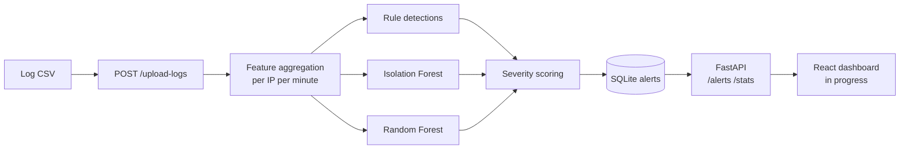

# ai-soc-alert-triage
AI-powered SOC alert triage: rule-based and ML threat detection (Isolation Forest, Random Forest) with a FastAPI backend, severity scoring and MITRE ATT&CK mapping.

> **Status:** backend and detection pipeline complete. React dashboard, Docker Compose and real-dataset evaluation are in progress.

## What it does

1. **Ingests** security logs (CSV) with fields such as timestamp, source IP, destination port, bytes, duration and failed logins.
2. **Aggregates** them into one row per source IP per minute.
3. **Detects** suspicious activity with two layers:
   - **Rules:** brute force, port scan, traffic spike
   - **ML:** an Isolation Forest (unsupervised anomaly score) and a Random Forest (supervised, class-weighted for imbalance)
4. **Scores** each alert 0-100 by combining the Random Forest probability, the anomaly score and rule hits, then labels it low, medium, high or critical.
5. **Maps** rule hits to MITRE ATT&CK techniques.
6. **Stores** alerts in SQLite so an analyst can filter them and set a status of open, investigating or closed.

## Architecture



## Severity score

```
severity = 100 * (0.5 * RandomForest probability + 0.2 * anomaly score + 0.3 * rule signal)
```

Bands: critical >= 80, high >= 60, medium >= 40, low below 40. The weights are a starting point and can be tuned.

## Detection rules

| Rule | Trigger (per IP per minute) | MITRE ATT&CK |
|---|---|---|
| Brute force | 10 or more failed logins | T1110 Brute Force |
| Port scan | 20 or more distinct destination ports | T1046 Network Service Discovery |
| Traffic spike | 5 MB or more of traffic | T1498 Network Denial of Service |

Thresholds live in `backend/rules.py`.

## API

| Method | Endpoint | Purpose |
|---|---|---|
| POST | `/upload-logs` | Upload a CSV, run detection, store alerts |
| GET | `/alerts` | List alerts (filter by `severity`, `status`, `src_ip`) |
| GET | `/alerts/{id}` | Get one alert |
| PATCH | `/alerts/{id}` | Update status (open, investigating, closed) |
| GET | `/stats` | Counts by severity and status, top IPs, timeline, model metrics |

Interactive docs are served at `/docs`.

## Quick start

```bash
git clone https://github.com/<your-username>/soc-alert-triage.git
cd soc-alert-triage
python3 -m venv .venv
source .venv/bin/activate
pip install -r requirements.txt

# model comparison table
python run_demo.py

# tests
python -m pytest -q tests

# API
uvicorn backend.main:app --reload
```

Generate a sample file and upload it at http://127.0.0.1:8000/docs:

```bash
python -c "from backend.synth import generate; generate(seed=7).to_csv('sample_logs.csv', index=False)"
```

## Results

### Synthetic data (pipeline check only)

The generator injects brute force, port scan, traffic spike and a slow "stealth scan" that stays under the rule thresholds. Because the data is synthetic and simple, these numbers only confirm the pipeline works. They are not a benchmark.

| Method | Precision | Recall | False positive rate |
|---|---|---|---|
| Rules only | 1.00 | 0.875 | 0.00 |
| Isolation Forest | 1.00 | 1.00 | 0.00 |
| Random Forest | 1.00 | 1.00 | 0.00 |

The rules miss the stealth scans, and the ML layer catches them.

### Real dataset (to be filled in)

| Method | Precision | Recall | False positive rate |
|---|---|---|---|
| Rules only | TBD | TBD | TBD |
| Isolation Forest | TBD | TBD | TBD |
| Random Forest | TBD | TBD | TBD |

Dataset: [CIC-IDS2017](https://www.unb.ca/cic/datasets/ids-2017.html) or [UNSW-NB15](https://research.unsw.edu.au/projects/unsw-nb15-dataset) (link the one you use). Raw data is not stored in this repo.

## Project structure

```
soc-alert-triage/
├── backend/
│   ├── features.py   # window aggregation
│   ├── rules.py      # rule detections + MITRE mapping
│   ├── ml.py         # Isolation Forest + Random Forest, evaluation
│   ├── pipeline.py   # severity scoring and alert creation
│   ├── synth.py      # synthetic log generator
│   └── main.py       # FastAPI app
├── tests/
│   └── test_rules.py
├── run_demo.py
└── requirements.txt
```

## Roadmap

- [x] Rule-based detections and unit tests
- [x] Isolation Forest and Random Forest comparison
- [x] FastAPI endpoints with SQLite storage
- [ ] React dashboard (alert table, severity chart, top attacker IPs, timeline)
- [ ] Evaluation on CIC-IDS2017 or UNSW-NB15
- [ ] Docker Compose
- [ ] Screenshots and live demo link

## Screenshots

_Add dashboard screenshots here once the frontend is built._

## Tech stack

Python, pandas, scikit-learn, FastAPI, SQLite, React (planned), Docker (planned)
